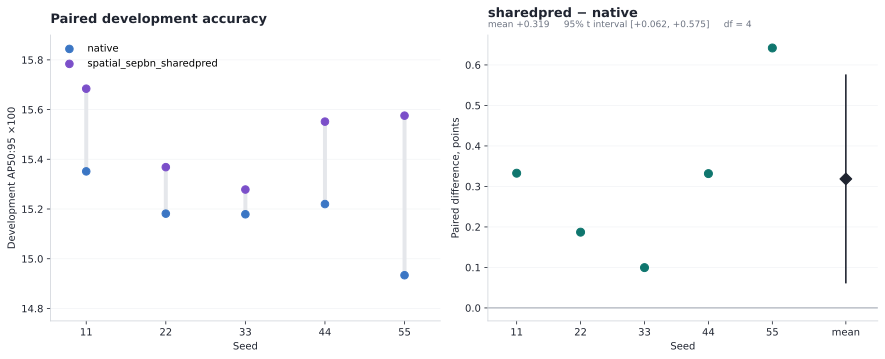
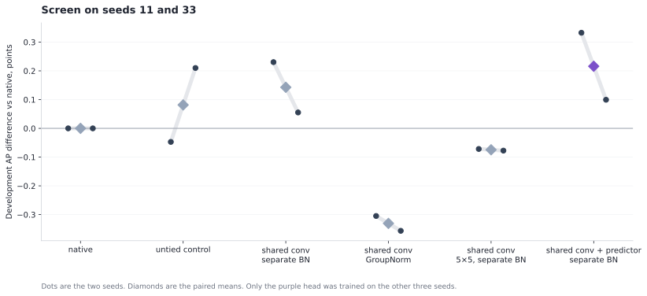
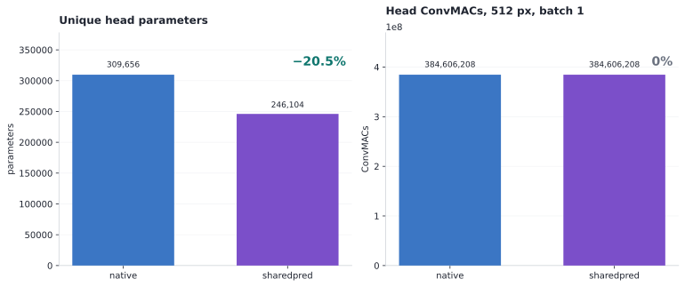
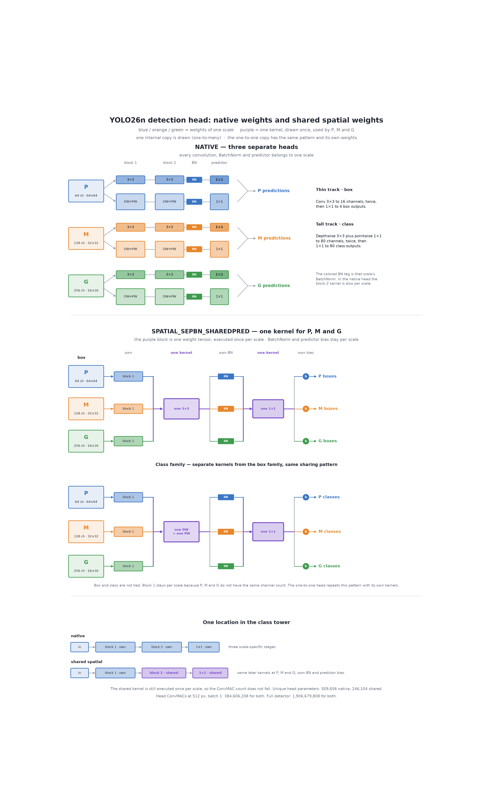

# Spatial Weight Sharing in a YOLO26n Detection Head


A controlled comparison of detection heads on one frozen YOLO26n trunk. The native head gives P, M and G their own weights. The selected head, `spatial_sepbn_sharedpred`, uses one convolution kernel for the three scales in the later block, and one predictor kernel, while each scale keeps its own BatchNorm. On the development split the paired difference is **+0.319 AP50:95 points** (15.492 versus 15.173, ×100), positive in 5 of 5 seeds, with **246,104** unique head parameters against **309,656**. Counted ConvMACs do not change. This page reports that development comparison. It is not a COCO val2017 result.

## Result at a glance

Development AP50:95 ×100. Five paired head seeds, 11, 22, 33, 44 and 55. Every fit ran 40 epochs. The checkpoint is the earliest best development score, measured every 5 epochs.

| | `native` | `spatial_sepbn_sharedpred` |
|---|---:|---:|
| Development AP50:95, mean ± sample SD | 15.173 ± 0.151 | **15.492 ± 0.165** |
| Paired difference vs `native` | | **+0.319** |
| Sample SD of that difference | | 0.206 |
| 95% t interval, df = 4 | | [+0.062, +0.575] |
| Seeds above native | | **5 of 5** |
| Unique head parameters, both internal branches | 309,656 | **246,104 (−20.5%)** |
| Head ConvMACs, 512 px, batch 1 | 384,606,208 | 384,606,208 (**0%**) |
| Full-detector ConvMACs, 512 px, batch 1 | 1,906,679,808 | 1,906,679,808 (**0%**) |

Seeds 11 and 33 chose the head. Seeds 22, 44 and 55 were new fits of that already chosen head and of new native controls. Those three confirmation seeds average **+0.387** points. The interval describes these five paired seeds. It is not an estimate for unseen images.

<p align="center">
  
</p>

| Seed | `native` | `spatial_sepbn_sharedpred` | Difference | Selected epochs |
|---:|---:|---:|---:|---|
| 11 | 15.351 | 15.684 | **+0.333** | 40 / 40 |
| 22 | 15.181 | 15.368 | **+0.187** | 35 / 35 |
| 33 | 15.179 | 15.278 | **+0.099** | 40 / 40 |
| 44 | 15.220 | 15.552 | **+0.332** | 35 / 40 |
| 55 | 14.934 | 15.576 | **+0.642** | 35 / 40 |
| **Mean** | **15.173** | **15.492** | **+0.319** | |

A selected epoch of 35 means that checkpoint had the best development score. Training still ran through epoch 40. Rows: [`results/shared-spatial/five_seed.csv`](results/shared-spatial/five_seed.csv).

### How the head was chosen

Six heads, seeds 11 and 33 only. The untied row copies the shared initialization and then trains separate weights. It is a control and could not win. The registered rule keeps the candidate with a strictly positive paired development mean. No other candidate was retrained.

<p align="center">
  
</p>

| Head | Unique parameters | Mean AP, seeds 11 and 33 | vs `native` |
|---|---:|---:|---:|
| `native` | 309,656 | 15.265 | |
| Untied control | 309,656 | 15.347 | +0.082 |
| Shared later conv, separate BN | 271,960 | 15.408 | +0.143 |
| Shared later conv and GroupNorm | 270,552 | 14.935 | −0.331 |
| Shared later conv, separate BN, 5×5 | 282,712 | 15.191 | −0.075 |
| **Shared later conv, separate BN, shared predictor** | **246,104** | **15.481** | **+0.216** |

GroupNorm and the 5×5 kernel were below native on this screen. Sharing the later convolutions and keeping BatchNorm was above native. Sharing the predictor kernel as well was the selected head. Screen rows: [`results/shared-spatial/screen.csv`](results/shared-spatial/screen.csv).

### Parameters and counted compute

<p align="center">
  
</p>

The shared kernel is still executed once per scale, so the operation count does not fall. The parameter count falls because P, M and G store that kernel once. Normalization, activation and decoding are not in the ConvMAC count. Latency and peak memory on the training GPU were not measured for this head.

## Architecture

<p align="center">
  
</p>

YOLO26n detects from three maps. P is 64 channels at 64×64, M is 128 channels at 32×32, and G is 256 channels at 16×16, at 512 px. Each map has a box branch and a class branch. The detector also has a second internal copy of those branches, the one-to-one head. The figure draws the one-to-many copy. The one-to-one copy has the same pattern and its own weights. Nothing is shared across box and class, or across the two copies.

The box branch is two 3×3 convolutions to 16 channels, then a 1×1 predictor to 4 outputs. The class branch is two separable blocks, each a depthwise 3×3 and a pointwise 1×1, to 80 channels, then a 1×1 predictor to 80 classes. Block 1 is what changes width. It stays per scale in every spatial variant, because the three maps do not enter with the same number of channels.

`spatial_sepbn_sharedpred` ties two things inside each family:

- the block-2 convolution weights, one kernel executed at P, M and G;
- the predictor kernel, with a separate bias at each scale.

BatchNorm stays per scale: affine weight, bias, and the running statistics. That is the whole difference from native. Width, depth and kernel size are unchanged.

The other screened heads move only that tied part. `spatial_sepbn` shares the block-2 convolution and not the predictor. `spatial_gn` replaces the three BatchNorms with one GroupNorm. `spatial_sepbn_k5` widens the shared 3×3 to 5×5. `spatial_untied` starts from the shared initialization and then keeps separate weights.

## Protocol

| Item | Value |
|---|---|
| Trunk | Frozen YOLO26n, artifact SHA-256 `f01ec41445fac9ef7078b48ef1b73473e6314bcb1a77e77c20666d6ecfcd9016`. The same trunk as the published looped-head study. |
| What is trained | The head only, on cached 512 px features. Not end-to-end training. |
| Dose | 40 epochs, batch 32, development AP every 5 epochs. |
| Selection | Earliest best development AP50:95. The 1,000-image training probe is not held-out accuracy. |
| Fits | 18 closed fits, no failures. Twelve screen fits, then six confirmation fits. |
| Code | Commit `4272ae2`, one RTX 5070 Ti. |
| Not run | COCO val2017. The holdout was not scored. |

The development split was used both to pick the checkpoint and, through seeds 11 and 33, to pick the head. The confirmation seeds were not used to pick the head. They are still development seeds, not val2017.

## Previous published result

The previous study asked a different question and got a negative answer. One looped head shared by P, M and G lost to the three native heads on COCO val2017: **14.333 versus 13.744 (−0.589)** for `loop_ab2`, and **13.600 (−0.733)** for `loop_a3`, each worse in 5 of 5 seeds. Those loops also used about 64% more head ConvMACs. That result is unchanged. The figure below is the architecture drawing from that study. It is not the head in the table above.

<p align="center">
  
</p>

The writeup, the val2017 table and the paired-difference and training-curve figures are in [docs/looped-result.md](docs/looped-result.md). Release [v0.2.0](https://github.com/Hmenez3s/detection-head-weight-sharing/releases/tag/v0.2.0) has the checkpoints. The head in this study does not repeat that loop. It keeps the native blocks, shares the later kernels, and leaves BatchNorm per scale.

An earlier experiment, release [v0.1.0](https://github.com/Hmenez3s/detection-head-weight-sharing/releases/tag/v0.1.0), tied a refiner inside one scale rather than across scales. Its drawing is [`assets/architecture.png`](assets/architecture.png). Its results remain in [`results/`](results/). It does not answer the question on this page.

<p align="center">
  
</p>

## Build this head

```python
from head_sharing.model import HeadStudyModel

model = HeadStudyModel(
    "native",
    11,
    512,
    head_spec={"version": 2, "variant": "spatial_sepbn_sharedpred"},
)
```

`head_spec=None` is the native head. The other registered variants are `spatial_sepbn`, `spatial_gn`, `spatial_sepbn_k5` and `spatial_untied`. The scores above are the committed tables. Constructing the module does not reproduce the fit. COCO images, feature caches and the selected checkpoints are not in this repository.

The figures are drawn by [`scripts/draw_shared_spatial.py`](scripts/draw_shared_spatial.py) from those tables. The looped-head figure is drawn by [`scripts/draw_looped_head.py`](scripts/draw_looped_head.py).

Code is AGPL-3.0. See [LICENSE](LICENSE) and [NOTICE.md](NOTICE.md) for Ultralytics YOLO26 and for COCO terms.
