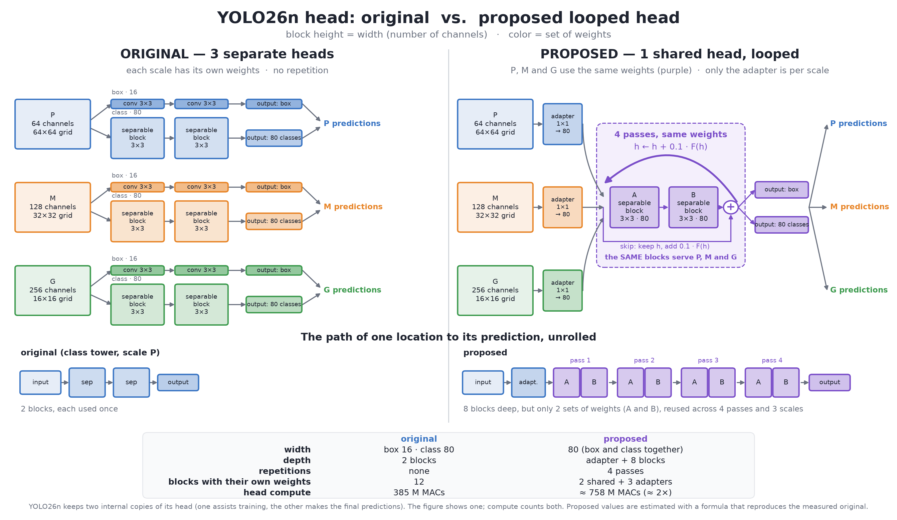

# One looped head for every scale

  

**Question.** Can one looped detection head, shared by the P, M and G scales, replace YOLO26n's three separate heads? By reusing what it learns about objects at one size for the others, could it detect more accurately at the same or slightly higher compute?

> **Status: design.** No model with this head has been trained yet. Nothing below is a result.

## The idea

- **Today**, each scale has its own head: P for small objects, M for medium, G for large. What the P head learns never reaches M or G.
- **Proposed**, each scale passes through a small 1×1 adapter to 80 channels. It then goes through **the same two blocks, applied four times** with a residual update `h ← h + 0.1·F(h)`, and **the same box and class outputs**.
- **The goal is generalization across scales and higher accuracy, not fewer parameters.** The head does about twice the original's convolution work; the full detector does about 20% more. Latency is measured as well, because every pass moves the feature maps through memory again, even when the weights are reused.

## Planned design

| | Original | Proposed |
|---|---|---|
| Heads | 3, one per scale | 1, shared by P, M and G |
| Width | box 16 · class 80 | 80, shared by box and class |
| Depth | 2 blocks | adapter + 8 blocks (4 passes of A, B) |
| Sets of weights | 12 blocks | 2 shared blocks + 3 adapters |
| Normalization | BatchNorm | GroupNorm: no running statistics mixed across passes or scales |
| Head compute | 385 M MACs (measured) | ≈758 M MACs (estimate) |

A learned output scale per level, as in FCOS, lets the shared outputs adjust to each scale.

## Planned comparison

| Arm | What it shows |
|---|---|
| `native` | The original three heads |
| `looped_per_scale` | The same looped head and compute, with separate weights for P, M and G |
| `looped_shared` | One looped head shared by all scales |

- **Decisive contrast: `looped_shared` − `looped_per_scale`.** Compute is identical; only sharing across scales differs.
- **Practical contrast: `looped_shared` − `native`.** Does the idea beat the original head?

All arms use the same frozen YOLO26n trunk and training recipe, five paired seeds, checkpoint selection on a development split, and final evaluation on COCO val2017. AP, latency and memory are reported for every arm.

**Still open before training:** the number of passes and the width, and whether box and class share one loop or keep separate looped towers.

## Repository

The code in `src/` and release [v0.1.0](https://github.com/Hmenez3s/detection-head-weight-sharing/releases/tag/v0.1.0) come from an earlier experiment. It tested a different, narrower change — repeating one layer inside each scale's head — and does not address this question.

The figure is generated by `scripts/draw_looped_head.py`. Code is licensed under AGPL-3.0; see [LICENSE](LICENSE) and [NOTICE](NOTICE.md).
