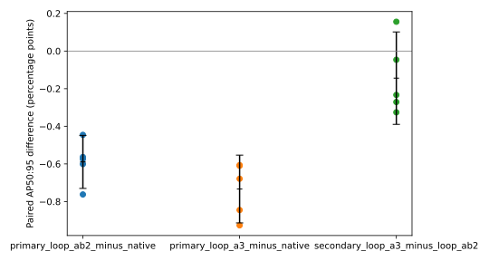
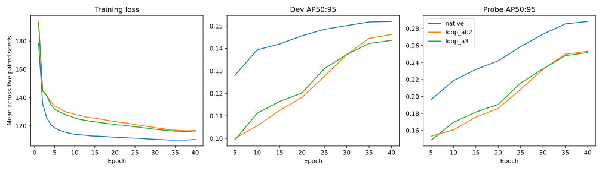

# One looped head for every scale: a negative result

**Result.** On the frozen YOLO26n trunk used here, a single looped detection head shared by the P, M and G scales was **less accurate than YOLO26n's three separate native heads**. Both looped designs lost about 0.6 to 0.7 AP points on COCO val2017, and each lost in all five paired seeds. We did not retune the looped heads to try to close the gap, and this study does not identify why they lost.

| COCO val2017, AP50:95 ×100, mean ± sample SD over 5 seeds | `native` | `loop_ab2` | `loop_a3` |
|---|---|---|---|
| **AP50:95** | **14.333 ± 0.110** | 13.744 ± 0.162 | 13.600 ± 0.072 |
| Paired difference vs `native` | n/a | −0.589 pp | −0.733 pp |
| 95% CI of that difference (marginal) | n/a | [−0.730, −0.448] | [−0.913, −0.553] |
| Holm-adjusted p (two primary tests) | n/a | 0.00063 | 0.00063 |
| Seeds where the loop was worse than native | n/a | 5 of 5 | 5 of 5 |
| Head parameters (both internal branches) | 309,656 | 181,920 | 183,504 |
| Head Conv MACs (both internal branches, 512 px) | 384.6 M | 631.4 M | 636.9 M |

The loops use about 41% fewer head parameters but about 64–66% more head compute than `native`, and they were less accurate. At batch 32 the full network was also about 39–43% slower (branch-pruned one-to-one deployment profile, on both GPUs we measured). The goal was accuracy and cross-scale generalization, not parameter reduction, so the smaller parameter count is not a win here. Accuracy was the primary question, and the answer was no.

<p align="center">
  
</p>

## Question

Can one looped detection head, shared by the P, M and G scales, replace YOLO26n's three separate heads? By reusing what it learns about objects at one size for the others, could it detect more accurately for a moderate increase in compute?

## The three arms

- **`native`**: the three separate head weights of YOLO26n, one per scale (P, M and G). The scales are not rigid small/medium/large bins.
- **`loop_ab2`**: one shared head. Box and class keep separate towers (they do not share weights with each other), and each tower is shared by P, M and G. Box width 24, class width 96. The loop applies two shared layers `A → B` twice.
- **`loop_a3`**: the same structure with box width 28, class width 108, and one shared layer `A` applied three times.

In the looped arms, per scale and per tower, an **adapter** (a depthwise 3×3 on the input channels plus a 1×1 projection to the tower width) brings the map to one width, and a **learned scale ID** is added. The three adapters of a tower are independent, specific to each scale, and still run three times, once per scale. The points of the three maps are flattened and concatenated into **one list of 5,376 points** (4,096 P · 1,024 M · 256 G, at 512 px). The loop uses only 1×1 convs with per-point channel norm and SiLU, so P, M and G points go through it together. There is no 3×3 inside the loop and no spatial mosaic or fusion. Each pass applies the shared layers once to the whole list with a residual update `h ← h + 0.1·F(h)`, where `F = B(A(h))` for `loop_ab2` and `F = A(h)` for `loop_a3`. A shared 1×1 readout, initialized with the native per-scale priors, produces the box and class outputs, which are split back to the native P, M and G geometry. Both the one-to-many and one-to-one internal branches are new in each looped arm.

| | `native` | `loop_ab2` | `loop_a3` |
|---|---|---|---|
| Heads | 3, one per scale | 1, shared by P, M and G | 1, shared by P, M and G |
| Box / class | separate | separate | separate |
| Width | box 16 · class 80 | box 24 · class 96 | box 28 · class 108 |
| Reused layers | none across scales | two layers A → B per tower | one layer A per tower |
| Passes | 2 blocks, once | 2 passes of `F = B(A(h))` | 3 passes of `F = A(h)` |
| Applications per point | 2 blocks | 4 | 3 |
| Conv applications per internal copy | 24 | 22 | 20 |
| Spatial view of the input feature map | 5×5 | 3×3 (adapter only) | 3×3 (adapter only) |

**Why this is not a clean test of weight sharing.** Each looped arm changes several things at once: sharing across scales, tower width, the adapters, per-point normalization, and the receptive field (5×5 native, 3×3 in the adapter only). The result tells us that these bundled looped designs were worse than native in this setup. It does not isolate weight sharing as the cause, and we do not claim gradient conflicts between scales as an observed cause.

## Accuracy

Five head seeds (11, 22, 33, 44, 55), COCO val2017 (all 5,000 images), scored after all 15 selections were frozen. Values are AP ×100.

**Primary metric, AP50:95 per seed**

| Seed | `native` | `loop_ab2` | `loop_a3` |
|---|---|---|---|
| 11 | 14.406 | 13.805 | 13.479 |
| 22 | 14.491 | 13.917 | 13.646 |
| 33 | 14.243 | 13.679 | 13.633 |
| 44 | 14.260 | 13.497 | 13.653 |
| 55 | 14.266 | 13.820 | 13.587 |
| **Mean ± sample SD** | **14.333 ± 0.110** | **13.744 ± 0.162** | **13.600 ± 0.072** |

**Paired differences vs `native`** (same seed, percentage points of AP50:95)

| Seed | `loop_ab2` − `native` | `loop_a3` − `native` |
|---|---|---|
| 11 | −0.601 | −0.927 |
| 22 | −0.574 | −0.845 |
| 33 | −0.563 | −0.610 |
| 44 | −0.762 | −0.607 |
| 55 | −0.446 | −0.679 |
| **Mean** | **−0.589** | **−0.733** |
| 95% t interval, df = 4 | [−0.730, −0.448] | [−0.913, −0.553] |
| Unadjusted two-sided p | 0.000316 | 0.000349 |
| Holm-adjusted p | 0.000632 | 0.000632 |

The Holm family contains only these two primary contrasts. The confidence intervals are marginal: they are not adjusted for multiplicity. Both loops were negative in all five seeds.

**Secondary, outside the primary family:** `loop_a3` − `loop_ab2` = −0.144 pp, 95% CI [−0.390, +0.102], unadjusted p = 0.179. The interval includes zero, which does not establish a difference or equivalence between the two loops. This study does **not** show that `loop_ab2` beats `loop_a3` (or the reverse).

**Mean AP by object size and threshold** (×100, 5 seeds; every per-seed value is in [`scores.csv`](results/looped/scores.csv))

| Metric | `native` | `loop_ab2` | `loop_a3` |
|---|---|---|---|
| AP50:95 | 14.333 | 13.744 | 13.600 |
| AP50 | 22.932 | 22.137 | 21.849 |
| AP75 | 14.960 | 14.407 | 14.268 |
| AP small | 5.070 | 4.368 | 4.453 |
| AP medium | 14.796 | 13.977 | 13.920 |
| AP large | 21.878 | 21.115 | 20.839 |

Both loops are lower on every metric in the table, including small objects. We did not run a separate analysis of whether the gap differs by object size.

<p align="center">
  
</p>

**Paired differences.** Each dot is one seed. The black marks are the mean and its 95% t interval (df = 4). The intervals are marginal, not adjusted for multiplicity. The two primary contrasts against `native` have all five seeds and their whole intervals below zero. The third contrast, `loop_a3` − `loop_ab2`, is secondary and outside the Holm family. It is mixed: four seeds are negative, one (seed 44) is positive, and the interval [−0.390, +0.102] crosses zero, so it shows no clear difference between the two loops. Data: [`paired_deltas.csv`](results/looped/paired_deltas.csv), [`summary.json`](results/looped/summary.json).

<p align="center">
  
</p>

**Training curves.** Mean over the five seeds for each arm: training loss per epoch (left), development-split AP50:95 at each 5-epoch evaluation (middle), and AP50:95 on the 1,000-image training probe at the same evaluations (right). The probe is drawn from the training split, so it is not held-out accuracy. Native's development AP flattens near epochs 35–40, while the two loops are still rising at the last evaluation; we did not train longer, so we cannot say what extra epochs would do. The per-seed probe-minus-development gap is in the CSV, not in the figure. Data: [`curves.csv`](results/looped/curves.csv).

## Cost, speed and memory

These come from fresh, matched profiles (36 in total, all completed) on two GPUs: seed 11 on an RTX 5070 Ti and seed 22 on an RTX 3060, using the fixed checkpoints of those seeds. They are one measurement set, not five independent timing replications, and not a ranking of the hardware.

**Structure** (measured per 512 px image; Conv multiply-accumulates only, so normalization, activation, add and decoding are not counted; "head" is the head alone)

| | `native` | `loop_ab2` | `loop_a3` |
|---|---|---|---|
| Unique head parameters, both internal branches | 309,656 | 181,920 | 183,504 |
| Head Conv MACs, both internal branches | 384.606 M | 631.357 M | 636.920 M |
| Full detector Conv MACs, both internal branches | 1,906.680 M | 2,153.431 M | 2,158.993 M |
| Unique head parameters, one-to-one branch only | 154,828 | 90,960 | 91,752 |
| Head Conv MACs, one-to-one branch only | 192.303 M | 315.679 M | 318.460 M |
| Full detector Conv MACs, one-to-one branch only | 1,714.377 M | 1,837.752 M | 1,840.534 M |

"One-to-one branch only" is a separate deployment-profiling policy: a copy of the model with the one-to-many branch pruned (`fused_one2one` in the profile files). It is not batch-norm fusion of the model. The COCO val2017 predictions were **not** made with this pruned copy: they load the retained dual-branch checkpoint and use its one-to-one outputs. The "both internal branches" rows describe the retained, trained model. The two loops are within about 0.9% of each other in head MACs, but not exactly equal. Head parameters fall about 41% from native while head Conv MACs rise about 64–66%. Conv MACs are a count of operations, not a latency prediction.

**Full-network latency** (milliseconds, branch-pruned one-to-one deployment-profiling policy; FP32, zero-valued 512×512 NCHW input, CUDA-synchronized, 5 warm-up and 20 timed repetitions; image decoding and preprocessing are excluded)

| GPU · batch | `native` | `loop_ab2` | `loop_a3` |
|---|---|---|---|
| RTX 5070 Ti · B1 | 16.445 | 17.207 | 16.477 |
| RTX 5070 Ti · B32 | 17.976 | 25.790 | 25.493 |
| RTX 3060 · B1 | 16.623 | 16.476 | 16.396 |
| RTX 3060 · B32 | 48.888 | 70.030 | 68.160 |

At batch 1 the differences are small and mixed in sign, within what we would expect from launch overhead, noise and bandwidth effects; we draw no speed conclusion from them. At batch 32 both loops were slower than native on both GPUs, by about 39–43% in this measurement. [`profiles.csv`](results/looped/profiles.csv) has the means for every profile (retained dual-branch and branch-pruned, full network and head only), plus storage, Conv MACs, and allocated and reserved memory. It has means only: the raw 20-sample timing vectors are in the individual `profile.json` files inside `evidence.tar.gz` (listed in `evidence/manifest.json`).

**Training memory** (batch 32; one warm-up plus one measured step of the selected weights, with cached head inputs, head loss and optimizer; peak **allocated** MiB)

| GPU | `native` | `loop_ab2` | `loop_a3` |
|---|---|---|---|
| RTX 5070 Ti | 1,432.188 | 2,484.133 | 2,233.706 |
| RTX 3060 | 1,431.039 | 2,491.732 | 2,242.058 |

This is a single step, not the peak of the full 40-epoch run, and it excludes trunk back-propagation (the trunk is frozen). Allocated and reserved memory are different quantities; `profiles.csv` has both, and inference memory is a separate scope. Portable checkpoint bytes and executable post-prune storage are also different, so we do not combine them.

## Method

- **One inherited trunk.** A single frozen YOLO26n trunk is shared by all 15 fits. It was trained **from scratch** on the same 11,629 COCO train images for 80 epochs (source seed 11, variant U), with no source head weights reused. It is not an official pretrained model, and the 5 seeds are 5 independent **heads** on one trunk, not 5 independent backbones ([trunk receipt](models/trunk-receipt.json)).
- **Head learning on frozen features.** Only the head is trained, on cached trunk features (512 px, FP32 → FP16 → FP32 quantization boundary). This is not end-to-end YOLO training.
- **Data.** Reduced train split of 11,629 images, a 2,000-image development split used only for checkpoint selection, and a 1,000-image train probe.
- **Training.** 40 epochs, batch size 32, development AP evaluated every 5 epochs, best development checkpoint selected per fit.
- **Matrix.** `native`, `loop_ab2`, `loop_a3` × seeds 11, 22, 33, 44, 55. That is 15 closed 40-epoch fits: 10 new fits and 5 reused native controls from the earlier study (same recipe, trunk and caches).
- **Freeze before evaluation.** All 15 selections were frozen (freeze SHA-256 `df3d874822a1c8015c312ac6f0ce8c59b4d64c1494c6ca55f5ddd70c5d7c2a47`) **before any new val2017 prediction**. The 10 new fits were then predicted on all 5,000 COCO val2017 images; the 5 native controls keep their original predictions and scores.
- **Full protocol and API:** [docs/looped-method.md](docs/looped-method.md). Frozen recipe: [configs/looped.frozen.json](configs/looped.frozen.json).

## Limitations

- **Reused benchmark.** COCO val2017, and the native controls, were already used in the earlier study in this repository. This is a reused benchmark, not an independent untouched confirmation.
- **One trunk, five seeds.** All comparisons are conditional on one inherited trunk, with n = 5 paired seeds. Uncertainty is substantial and the confidence intervals are marginal.
- **Bundled changes.** The looped arms differ from native in width, adapters, normalization and receptive field as well as in weight sharing. We cannot attribute the loss to sharing alone, and we do not offer a cause.
- **No retuning.** Hyperparameters and schedule are the frozen native recipe. Different widths, passes, learning rates or end-to-end training could behave differently. We did not try them, and this result says nothing about them.
- **Scope.** One detector (YOLO26n), one dataset (COCO), one resolution (512 px), and frozen features. We make no claim that cross-scale head sharing fails in general, or works elsewhere.
- **Cost measurements** come from two GPUs, with representative seeds 11 and 22 only and a single set of repetitions.

## Reproduce and download

The COCO dataset is not in this repository. Release [v0.2.0](https://github.com/Hmenez3s/detection-head-weight-sharing/releases/tag/v0.2.0) contains the checkpoints and the closed evidence (predictions, score bindings and checkpoint data):

| File | Contents |
|---|---|
| [`models.tar.gz`](https://github.com/Hmenez3s/detection-head-weight-sharing/releases/download/v0.2.0/models.tar.gz) | all 15 selected head checkpoints with their configs, `model-index.json`, and the common trunk once (`models/trunk.pt`) |
| [`evidence.tar.gz`](https://github.com/Hmenez3s/detection-head-weight-sharing/releases/download/v0.2.0/evidence.tar.gz) | closed predictions, score bindings, and the evidence manifest |
| [`budget.json`](https://github.com/Hmenez3s/detection-head-weight-sharing/releases/download/v0.2.0/budget.json) | compute-budget record |
| [`SHA256SUMS`](https://github.com/Hmenez3s/detection-head-weight-sharing/releases/download/v0.2.0/SHA256SUMS) | checksums of the three files above |

Download all three assets and `SHA256SUMS` into one directory, then verify before extracting:

```sh
base=https://github.com/Hmenez3s/detection-head-weight-sharing/releases/download/v0.2.0
for f in models.tar.gz evidence.tar.gz budget.json SHA256SUMS; do curl -LO "$base/$f"; done
sha256sum -c SHA256SUMS
tar xzf models.tar.gz && tar xzf evidence.tar.gz
```

**Replay the analysis** (reads the bundled evidence; needs no dataset and no official annotation file). Use Python 3.12 and the pinned dependencies:

```sh
pip install -e .
python -m head_sharing.analyze --input evidence/manifest.json --output replay-results
```

`replay-results` must not exist yet. The tables above are the committed copy of that output in [`results/looped/`](results/looped/). A complete re-score from raw predictions uses the public `python -m head_sharing.evaluate score` CLI and the official `instances_val2017.json` ([COCO terms](https://cocodataset.org/#termsofuse)). Re-measuring cost needs matching GPU hardware and pinned versions; latency and memory will differ elsewhere.

**Use a checkpoint** (CPU; the heads need the common trunk):

```python
from head_sharing.checkpoint import load_checkpoint

model = load_checkpoint(
    "models/heads/11/loop_ab2.pt",
    "models/heads/11/loop_ab2.json",
    trunk_artifact="models/trunk.pt",
    map_location="cpu",
)
```

## Provenance

- **Compute.** The study ran on two local GPUs under a cumulative conservative allocator that charges every reservation in full, including failed attempts and pilots, with no refunds. Charges at the end of the study were 100,075 s (27.80 h) on the RTX 3060 and 104,305 s (28.97 h) on the RTX 5070 Ti, each within the 48 h per-device limit ([`budget.json`](https://github.com/Hmenez3s/detection-head-weight-sharing/releases/download/v0.2.0/budget.json)). During main training the sampled physical free VRAM never fell below 50.8% of the card, and at most three main fits ran concurrently (9 CPU cores).
- **One resumed fit.** The `loop_a3` seed 22 fit resumed from epoch 6 after a bookkeeping failure, with the full RNG, optimizer and history state restored. It was not retuned and given no extra epochs.
- **Code versions.** Fits were run over several commits. A bounded batch-reader change (`91209cf`) preserved bytes, losses, gradients and SGD updates in an equivalence check, and a later change (`8610c0f`) altered only runtime wait and watchdog behavior. The commit each fit actually ran from is recorded in the model index and freeze receipt, so not every fit came from the latest code.
- **Licenses.** Code is AGPL-3.0, see [LICENSE](LICENSE) and [NOTICE](NOTICE.md) for attribution of Ultralytics YOLO26 and for COCO annotation and photograph terms. Dataset access is not a grant of rights to the photographs.

## Earlier experiment

Release [v0.1.0](https://github.com/Hmenez3s/detection-head-weight-sharing/releases/tag/v0.1.0) is an earlier experiment in this repository. It tested a different, narrower change, repeating one layer inside each scale's head (intra-scale units), not sharing across scales, so it does not address the question here. Its results remain at the top level of [`results/`](results/); this study's results are in [`results/looped/`](results/looped/). The figure is generated by [`scripts/draw_looped_head.py`](scripts/draw_looped_head.py).
