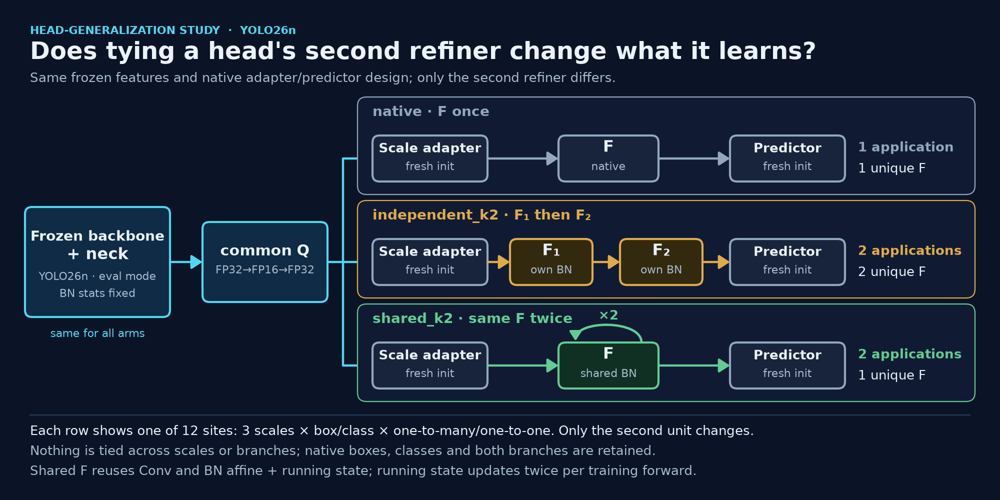
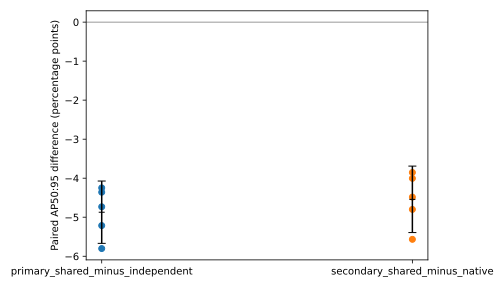
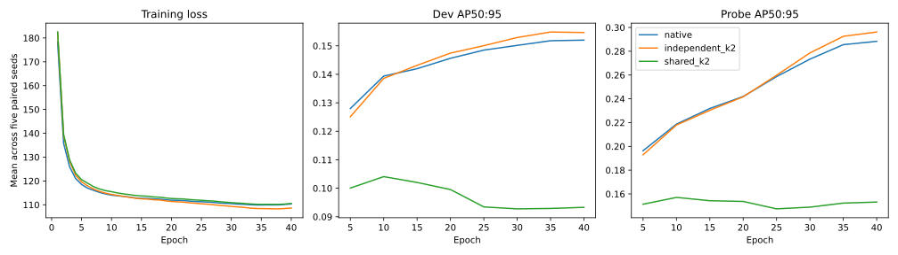

# Does sharing a detection-head refinement block help?

A controlled, head-only YOLO26n study finds a clear downside in this setting: applying one refinement block twice with tied weights scored **4.87 AP points below** two independent copies. The shared-weight arm was lower in **all five paired seeds**. This is evidence about one fixed protocol and one inherited trunk—not a general verdict on weight sharing.

> **Scope — what this study does not test.** `shared_k2` repeats one existing convolutional unit twice *inside each* of the separate per-scale heads. There is no residual update, only two applications, and the repeated unit's BatchNorm running statistics are shared across both passes. It does **not** test a single looped head shared across the P3/P4/P5 scales in place of the three heads, nor a residual recurrent refiner such as `h ← h + α·F(h)`. These results are not evidence against either design.

All 15 training runs completed 40 epochs. The selected checkpoints were evaluated on all 5,000 COCO val2017 images, and all 24 declared CUDA profiles were collected. No further experiments or tuning are part of these results.

| Arm | Refinement at each of 12 head sites |
|---|---|
| `native` | Original second-unit block |
| `independent_k2` | Two distinct, initially equal blocks applied in sequence |
| `shared_k2` | One block object applied twice in sequence |



## Accuracy result

COCO bbox AP50:95 is reported on a 0–100 scale. Each row uses the same paired head-initialization/training seed across arms. The five selected models in each arm are all reported; no best-seed substitution.

| Seed | Native | Independent | Shared | Shared − independent (pp) |
|---:|---:|---:|---:|---:|
| 11 | 14.41 | 14.80 | 10.55 | −4.25 |
| 22 | 14.49 | 14.73 | 8.92 | −5.80 |
| 33 | 14.24 | 14.60 | 10.24 | −4.36 |
| 44 | 14.26 | 14.67 | 9.46 | −5.21 |
| 55 | 14.27 | 14.51 | 9.78 | −4.73 |
| **Mean ± seed SD** | **14.33 ± 0.11** | **14.66 ± 0.11** | **9.79 ± 0.64** | **−4.87 ± 0.64** |

The primary paired contrast is **shared − independent = −4.8713 pp**, with a two-sided 95% t interval of **[−5.6700, −4.0726]** (n=5 paired seeds, df=4); all five differences are negative. The secondary contrast, shared − native, is **−4.5414 pp** (95% t interval **[−5.3933, −3.6896]**). These intervals describe variation across five head/training seeds conditional on a single fixed trunk. They do not represent variation across independently trained trunks or datasets, and do not establish equivalence.





## What was compared

All heads were newly initialized; no source-head weights were reused. A single YOLO26n trunk, trained from scratch for 80 epochs on the same 11,629 COCO training images using native source augmentation, was inherited and frozen—including normalization buffers—for every run. Thus this is a **conditional head-refinement comparison**, not scratch few-shot learning, independent-trunk generalization, or a stock-pretrained-baseline comparison.

At each of 12 sites (box and classification units × three feature scales × two native branches), `independent_k2` has two separate blocks with equal initial values, not aliased parameters. `shared_k2` calls the same block twice. Sharing is within each site only: there are no ties across scales or between branches. Native decoding, top-k selection, and the dual-branch loss remain in place. BatchNorm state in the shared block is updated twice per forward, versus once for each independent copy; consequently this is not a pure weight-only causal attribution.

The frozen main recipe used five paired seeds (11, 22, 33, 44, 55), 40 epochs, batch 32, 512-pixel inputs, SGD, and evaluation every five epochs. There was no EMA. Training used simple pixel-space horizontal flips. The common precision boundary is FP32 frozen-trunk features → FP16 roundtrip → FP32 head; training used BF16 and reported metrics use FP32.

For each seed and arm, the **earliest** checkpoint with the maximum AP50:95 on the 2,000-image development set was selected. A separate clean 1,000-image train probe is not the final test. Identities for all 15 selected checkpoints were frozen before validation annotations were accessed for predictions or scoring. Final evaluation covered the complete 5,000-image COCO val2017 set.

The common postprocessor promotes scores to float64, retains scores at `>= 0.001`, and applies a stable top-300 cap; official COCO bbox scoring uses maxDets 100. This is not exact stock Ultralytics strict-boundary behavior: native filtering compares in tensor dtype with `> 0.001`. The same frozen adapter was used for all arms and cohorts; it was not retuned after seeing the results.

## Model size, computation, and measured runtime

Structural counts below distinguish unique parameter counts from serialized head-weight file size; neither represents repeated calls. Convolution MACs count every executed convolution, including both executions of the shared block.

| Arm | Unique head parameters | Full model parameters | Serialized head-weight file (MiB) | Full Conv (GMac, batch 1) | Head Conv (GMac, batch 1) |
|---|---:|---:|---:|---:|---:|
| `native` | 309,656 | 2,572,280 | 1.2686 | 1.9067 | 0.3846 |
| `independent_k2` | 368,312 | 2,630,936 | 1.5316 | 2.0080 | 0.4859 |
| `shared_k2` | 309,656 | 2,572,280 | 1.2733 | 2.0080 | 0.4859 |

Compared with `independent_k2`, `shared_k2` reduces unique head parameters by **15.93%** and full-model parameters by **2.23%**, while executing the same convolution MACs. The small difference between native and shared head-weight bytes reflects their stored state, not a difference in parameter count.

CUDA latency is mean milliseconds per batch, measured with five warmups and 20 synchronized repetitions at 512 pixels. Full-detector runs retain both native branches; head-only timing uses common quantized features. Preprocessing, data loading, and I/O are excluded; the quantization boundary is included.

| GPU / representative seed | Batch | Arm | Full (ms/batch) | Head (ms/batch) |
|---|---:|---|---:|---:|
| RTX 5070 Ti / 11 | 1 | Native / Independent / Shared | 19.33 / 22.60 / 22.40 | 6.87 / 9.48 / 9.32 |
| RTX 5070 Ti / 11 | 32 | Native / Independent / Shared | 21.01 / 23.95 / 23.68 | 7.58 / 10.27 / 10.23 |
| RTX 3060 / 22 | 1 | Native / Independent / Shared | 19.51 / 21.58 / 21.13 | 6.92 / 9.06 / 8.99 |
| RTX 3060 / 22 | 32 | Native / Independent / Shared | 57.00 / 62.48 / 62.57 | 17.59 / 23.52 / 23.48 |

At batch 32, PyTorch inference peak allocated memory was **650.1128 MiB** for native/shared and **650.3735 MiB** for independent on each GPU. In the separate brief BF16 cached-training probe at batch 32, peaks were 5070 Ti: 1432.19 / 1779.42 / 1778.58 MiB; RTX 3060: 1431.04 / 1778.39 / 1777.56 MiB (native / independent / shared). These are PyTorch allocated peaks, not driver/process or whole-fit VRAM. The training probe is not the main-fit peak. Profiles use representative trained checkpoints (seed 11 on the 5070 Ti; seed 22 on the 3060), not five-seed footprint replications; do not pool across GPUs. The [`results/profiles.csv`](results/profiles.csv) is a summary; detailed raw measurements—including baselines, reserved-memory peaks, per-sample timings, and head latency—are referenced by `evidence/manifest.json` in `evidence.tar.gz`.

Unique parameter counts, serialized weight-file bytes, ConvMACs, allocated/reserved memory, and latency are different quantities. Sharing preserves two block executions and the same MAC count as independent copies. Here it yielded only a tiny allocator difference, no consistent latency advantage, and lower AP.

## Download and inspect the release

The [`v0.1.0` GitHub release](https://github.com/Hmenez3s/detection-head-weight-sharing/releases/tag/v0.1.0) contains these assets:

- [`models.tar.gz`](https://github.com/Hmenez3s/detection-head-weight-sharing/releases/download/v0.1.0/models.tar.gz) — 24,337,420 bytes; 35 regular files.
- [`evidence.tar.gz`](https://github.com/Hmenez3s/detection-head-weight-sharing/releases/download/v0.1.0/evidence.tar.gz) — 607,893,116 bytes; 147 files.
- [`budget.json`](https://github.com/Hmenez3s/detection-head-weight-sharing/releases/download/v0.1.0/budget.json) — public accounting audit (22,520 bytes).
- [`SHA256SUMS`](https://github.com/Hmenez3s/detection-head-weight-sharing/releases/download/v0.1.0/SHA256SUMS) — checksums for those three assets.

Clone the source repository, download the four release assets into its root directory, then verify and extract them under `release-files/`:

```sh
git clone https://github.com/Hmenez3s/detection-head-weight-sharing.git
cd detection-head-weight-sharing
# Download models.tar.gz, evidence.tar.gz, budget.json, and SHA256SUMS from the release page.
sha256sum -c SHA256SUMS
mkdir -p release-files
tar -xzf models.tar.gz -C release-files
tar -xzf evidence.tar.gz -C release-files
```

The archives contain the model and evidence trees respectively. The model index is `release-files/models/model-index.json` (not `models-index.json`). The model archive includes the shared `models/trunk.pt` and its receipt, plus all 15 development-selected head checkpoints and configs under `models/heads/<seed>/<arm>.pt` and `.json`; it does not cherry-pick a seed. The evidence archive contains the frozen protocol and selection/freeze record, receipts and producer records, selected weights/configs, predictions and scores, all 24 profiles, manifest, license/notice material, and result CSV/JSON/SVG files. It excludes images, ground truth, private source checkpoints, and private operational data.

### CPU checkpoint loading smoke test

The source package requires Python 3.12 (`>=3.12,<3.13`). From the cloned source checkout, with the model archive extracted under `release-files/`, create an environment and install the pinned project dependencies:

```sh
python3.12 -m venv .venv
. .venv/bin/activate
python -m pip install -e .
```

This CPU example checks that one published checkpoint loads and produces finite outputs of the expected shape. A zero tensor is only a construction/forward smoke test—not an accuracy evaluation. Real input must be normalized RGB letterboxed to 512 pixels.

```python
import torch
from head_sharing.checkpoint import load_checkpoint

model = load_checkpoint(
    "release-files/models/heads/11/native.pt",
    "release-files/models/heads/11/native.json",
    trunk_artifact="release-files/models/trunk.pt",
    map_location="cpu",
).eval()
with torch.inference_mode():
    detections = model.forward_images(torch.zeros(1, 3, 512, 512))[0]
assert detections.shape == (1, 300, 6)
assert torch.isfinite(detections).all()
```

### Replay released scores and analysis

Scoring saved predictions and replaying the aggregate analysis can run on CPU; they do not require model inference. COCO validation annotations are **not** included. Obtain them separately under the [COCO terms](https://cocodataset.org/#termsofuse); the expected official val annotation SHA-256 is `e8c7f7908f1d7278341fae127d0da654f102f11bd7b21d8aeefa635b8c810b6f`.

From the source checkout, with `evidence.tar.gz` extracted into `release-files/`, score one saved prediction file (native seed 11; the successful prediction is attempt 002):

```sh
python -m head_sharing.evaluate score \
  --freeze release-files/evidence/selection/selected.json \
  --owned-root release-files/evidence \
  --annotations /path/to/instances_val2017.json \
  --predictions release-files/evidence/final/predict-s11-native/attempt-002/predictions.json.gz
```

To replay the hash-bound full matrix and profiles into a new output directory:

```sh
MPLBACKEND=Agg python -m head_sharing.analyze \
  --input release-files/evidence/manifest.json \
  --output replayed-results
```

Production prediction/training is guarded to the study's authorized GPU UUIDs; CPU deployment and scoring saved predictions are portable, but arbitrary-GPU retraining is not promised. CPU prediction mode is restricted to synthetic fixtures. Exact SHA-bound validation/review receipts and checked reproduction commands are documented in the release notes.

## Budget, provenance, and limitations

The public GPU budget conservatively charges all failed, pilot, cache, evaluation, and profile reservations: **54,715 seconds (15.20 hours) on the RTX 3060** and **49,945 seconds (13.87 hours) on the RTX 5070 Ti**, each within a 16-hour cap. Charges are not refunded or transferred. The inherited 80-epoch source-trunk training is prior work, not part of the new head-only budget. See `budget.json` for the release audit.

The source implementation is pinned to Ultralytics 8.4.177 and source revision `ab3bd58844b0fa5fda4c14523ad6de8c87687479`; exact upstream digests are recorded in [`upstream.json`](upstream.json). Raw measurement code is pinned to [`2534100`](https://github.com/Hmenez3s/detection-head-weight-sharing/commit/25341005a274b090231da4c69e991ee3a025677d); a later public-profile startup guard fix did not change the numerical measurement path. Full methods and the safety/implementation details are in [docs/method.md](docs/method.md) and [docs/runtime.md](docs/runtime.md). The result tables are [scores](results/scores.csv), [paired deltas](results/paired_deltas.csv), and [profiles](results/profiles.csv); the machine-readable summary is [summary.json](results/summary.json).

The primary estimate is based on five paired seeds and one trunk; no inference is made about other trunks, datasets, architectures, or training regimes. There is no claim of state-of-the-art performance, a stock pretrained-baseline comparison, or equivalence.

## License and citation

Repository source and derived detector checkpoints are licensed under **AGPL-3.0**; see [LICENSE](LICENSE) and [NOTICE](NOTICE.md). COCO annotations are **CC BY 4.0**; image rights remain with individual creators and their applicable licenses. The release does not include COCO images or ground-truth annotations.

For the study artifacts, cite this repository and release `v0.1.0`: https://github.com/Hmenez3s/detection-head-weight-sharing. Also cite the dataset and implementation:

- Tsung-Yi Lin et al., “Microsoft COCO: Common Objects in Context,” ECCV 2014, https://arxiv.org/abs/1405.0312.
- Ultralytics YOLO26, version 8.4.177, https://github.com/ultralytics/ultralytics.
